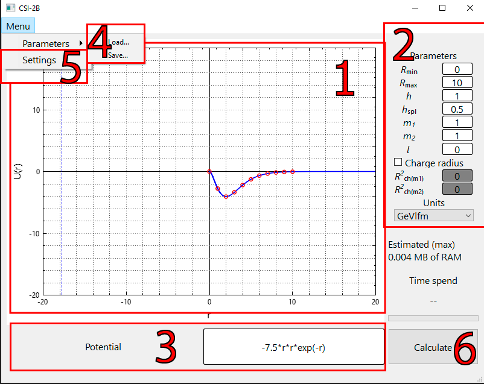
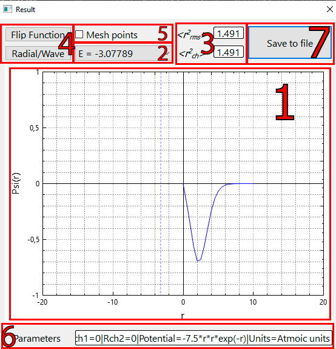

# Interface overview
## Main window

The main window has several parts of the interface.
### 1. The potential graph.
The potential graph is shown as the blue line with red cicles, which represent computational grid.

You can navigate through the graph:
- hold the left mouse button to move it;
- scroll the mouse wheel to scale up and down the graph;
- scroll the mouse wheel at axes to scale it up and down.

Besides it, coordinates are shown at the tip of the mouse cursor.

### 2. Fields for enetering parameters of the problem.

3. The field for entering the potential equation.
4. Save/load buttons for parameters.
5. Settings button.
6. Calculate button.
## Settings window
## Results window

## Save file window

# Calculation example
